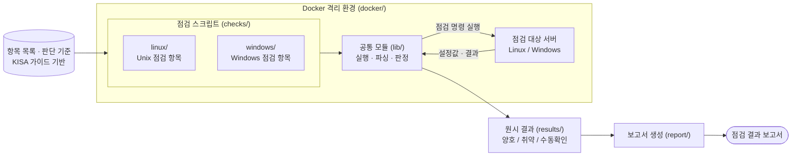

# kisa-vuln-checker — KISA 기준 서버 취약점 자동 점검

> 🚧 진행 중 (25개 항목 구현 — 계정관리·파일권한·서비스관리·패치관리·로그관리 완료, 전 항목 검증 완료)

## 개요
- 목적: 2026 KISA 「주요정보통신기반시설 기술적 취약점 분석·평가」 Unix/Windows 항목 자동 점검

## 아키텍처


| 구성 요소 | 경로 | 역할 |
|---|---|---|
| 점검 스크립트 | `checks/linux`, `checks/windows` | KISA 항목별 점검 로직 |
| 공통 모듈 | `lib/` | 명령 실행, 출력 파싱, 양호/취약 판정 |
| 실행 환경 | `docker/` | 격리된 환경에서 재현 가능한 실행 |
| 결과 | `results/` | 항목별 판정 결과 저장 |
| 보고서 | `report/` | 결과를 취합해 보고서로 출력 |

## 핵심 결과
- 점검 항목 25개 (계정관리 5개: U-01~U-05, 파일권한 5개: U-14~U-18, 서비스관리 5개: U-19~U-23, 패치관리 5개: U-24~U-28, 로그관리 5개: U-29~U-33) / 자동화율 100%
- **양호 컨테이너(docker/Dockerfile.ok) 25/25 "양호" 판정 → 오탐 0건**
- **취약 컨테이너(docker/Dockerfile.vuln) 25/25 전부 기대값과 일치 → 미탐 0건** (U-03은 2단계 디버깅 끝에 최종 해결, U-29는 ubuntu:22.04 베이스 이미지에 기본 생성된 /var/log/journal로 인한 오판정을 발견해 수정, U-04는 Dockerfile.vuln에 별도 조치가 없어 양호가 기대값, 상세: docs/검증결과.md)

## 실행 방법
```bash
# 취약 컨테이너 (25개 항목 모두 '취약' 판정이어야 함, U-04 제외)
docker build -f docker/Dockerfile.vuln -t checker:vuln .
docker run --rm checker:vuln > results/vuln.json

# 양호 컨테이너 (25개 항목 모두 '양호' 판정이어야 함 — 오탐 확인용)
docker build -f docker/Dockerfile.ok -t checker:ok .
docker run --rm checker:ok > results/ok.json
```

컨테이너 내부(또는 대상 서버)에서는 `run_all.sh`가 `checks/linux/U-*.sh`를 모아 실행합니다. 개별 점검 스크립트를
블랙박스로 보고, 실행기 레벨에서 다음을 보장합니다.
- **타임아웃**: 스크립트 하나가 멈춰도 `TIMEOUT`초(기본 70) 뒤 강제 종료 후 `N/A`로 기록, 전체 실행은 계속 진행
- **권한 부족/비정상 종료 흡수**: 크래시·잘못된 출력·"Permission denied"류 에러를 전체 JSON 배열을 깨뜨리지 않고 개별 `N/A` 레코드로 흡수(권한 부족은 별도 사유로 구분)
- **병렬 실행**: `PARALLEL`개씩 동시 실행(기본 CPU 코어 수)으로 전체 실행 시간 단축

```bash
# 기본값으로 실행
./run_all.sh > results/vuln.json

# 타임아웃·동시 실행 수 조정
TIMEOUT=30 PARALLEL=4 ./run_all.sh > results/vuln.json
```

## 상세 문서
- docs/항목목록.md, docs/항목별_판단기준.md, docs/검증결과.md (취약/양호 컨테이너 실행 결과)
- report/kisa-vuln-checker_1차_보고서.docx (프로젝트 의의, Docker 설계, 공통 모듈 설계, U-01~U-05, U-14~U-18 설계 과정)
- report/kisa-vuln-checker_2차_보고서.docx (서비스관리·패치관리·로그관리 U-19~U-33 설계 과정, 명령 출력 모의 래퍼 기법, 11일차 실행 전까지의 진행 경과)

## 법적 고지
본 도구는 격리된 로컬 환경에서만 사용했습니다.
