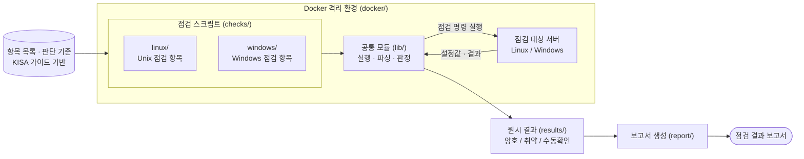

# kisa-vuln-checker — KISA 기준 서버 취약점 자동 점검

> 🚧 진행 중 (예정 공개: 2026-11-29)

## 개요
- 목적: 2026 KISA 「주요정보통신기반시설 기술적 취약점 분석·평가」 Unix/Windows 항목 자동 점검

## 아키텍처


| 구성 요소 | 경로 | 역할 |
|---|---|---|
| 점검 스크립트 | `checks/linux`, `checks/windows` | KISA 항목별 점검 로직 |
| 공통 모듈 | `lib/` | 명령 실행, 출력 파싱, 양호/취약 판정 |
| 실행 환경 | `docker/` | 격리된 환경에서 재현 가능한 실행 |
| 결과 | `results/` | 항목별 판정 결과 저장 |
| 보고서 | `report/` | 결과를 취합해 보고서로 출력 |

## 핵심 결과
- 점검 항목 N개 / 자동화율 __% / 오탐 __건

## 실행 방법
```bash
docker build -f docker/Dockerfile.vuln -t checker:vuln .
docker run --rm checker:vuln
```

## 상세 문서
- docs/항목목록.md, docs/항목별_판단기준.md, docs/검증결과.md

## 트러블슈팅 & 배운 점

## 법적 고지
본 도구는 격리된 로컬 환경에서만 사용했습니다. KISA 가이드 PDF 원본은 포함하지 않습니다.
